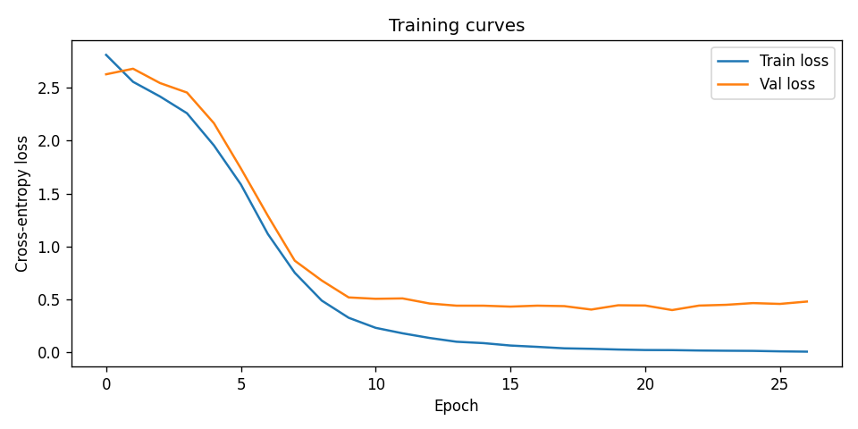

# Georgian Spellchecker: Character-Level Encoder-Decoder LSTM

A character-level seq2seq model (2-layer LSTM encoder + 2-layer LSTM decoder, ~6.6M parameters) that
takes a possibly misspelled Georgian word and outputs the corrected word. Built for a Deep Learning course
assignment and trained entirely on **synthetic data**. See [Limitations](#limitations).

[](https://colab.research.google.com/github/ninoNebieridze/GeorgianSpellcheck/blob/main/data_training_and_inference.ipynb)

## How it works

1. **Vocabulary (synthetic).** 302 hand-picked Georgian base words are expanded with common suffixes
   (`-ის`, `-ში`, `-დან`, `-ური`, …) and prefixes (`სა-`, `გა-`, `მო-`, …), giving about 7,650 unique strings.
   The expansion is mechanical, so many generated forms are not real Georgian words.
2. **Error generation.** 70% of words get 1–2 random errors (keyboard-neighbour substitution, deletion,
   insertion, transposition, doubling). 30% are kept unchanged so the model learns to leave correct words alone.
3. **Model.** Character embeddings (64-d) → LSTM encoder (512 hidden, 2 layers) → LSTM decoder that generates
   the corrected word character by character, using greedy decoding at inference time.
4. **Training.** Adam (lr 1e-3), cross-entropy, teacher forcing 0.5, gradient clipping, LR-on-plateau,
   90/10 train/val split. The best checkpoint by validation loss is saved to `spellchecker.pt`.

## Repository contents

| File | Description |
|---|---|
| `data_training_and_inference.ipynb` | Full pipeline: data generation, training, evaluation (Part 1) and inference (Part 2) |
| `spellchecker.pt` | Trained checkpoint (weights + character vocabulary + config) |
| `assets/loss_curve.png` | Training/validation loss curves |
| `requirements.txt` | Python dependencies |

## How to run

### Google Colab (recommended)
1. Open the notebook in Colab (badge above, or *File → Upload notebook*).
2. Use a GPU runtime: *Runtime → Change runtime type → T4 GPU*. Training also works on CPU, but much more slowly.
3. **To train from scratch and evaluate:** *Runtime → Run all*. This regenerates the data, trains for up to
   30 epochs, overwrites `spellchecker.pt`, and prints the validation accuracy (section 8).
4. **To run inference with the provided checkpoint only:** upload `spellchecker.pt` to the Colab file panel
   and run the cells under **Part 2: Inference**. Then call `correct_word('გამარჰობა')`.

### Locally
```bash
pip install -r requirements.txt jupyter
jupyter notebook data_training_and_inference.ipynb
```

## Results



Training stopped early at epoch 27. The best validation loss was 0.400 (epoch 22), while the final train loss was 0.007.

**Validation exact-match accuracy** (766 held-out pairs, greedy decoding; the output must equal the target exactly):

| Input type | N | Correct | Accuracy |
|---|---:|---:|---:|
| Corrupted inputs (should be fixed) | 547 | 199 | 36.4% |
| Already-correct inputs (should be left unchanged) | 219 | 136 | 62.1% |
| All | 766 | 335 | 43.7% |

**How to read these numbers:**

- **Many failures come from the synthetic vocabulary.** The "correct" targets include made-up forms
  such as `ლიტერატურაება` and `მტრედიური`. Several suffixes compete for the same stem (`-ობა`/`-ება`, `-ული`/`-ური`,
  `-ის`/`-ით`), so a corrupted input is often ambiguous between two equally fake targets. Exact match counts these
  as failures even when the stem is right. Half of the 10 failures printed in the notebook are of this kind, e.g.
  `ლიტერატუღრაბა` → `ლიტერატურაობა` (expected `ლიტერატურაება`) and `ქართულშურეი` → `ქართულიული` (expected
  `ქართულიური`). The other half are real errors, where the model produces a garbled or unrelated word.
- **The main weakness is changing words that are already correct.** The model leaves only 62.1% of correct
  validation words unchanged, so it alters the other 38% (83 of 219), e.g. `წვიმაია` → `ვითარიობა`. A
  spellchecker mostly sees correct text, so this is the most harmful failure in practice: it would introduce
  errors more often than a user would accept.

The notebook also includes a hand-picked 23-word demo, on which the model gets 16/23 right. This is **only an
illustration**: the sample is tiny, chosen by hand, and mostly made of words seen during training.

Example corrections from the demo:

| Input | Output | |
|---|---|---|
| გამარჰობა | გამარჯობა | ✓ |
| პრგრამა | პროგრამა | ✓ |
| მეცინერება | მეცნიერება | ✓ |
| თბილიი | თვილიული | ✗ (expected თბილისი) |
| მადლობა | მამავიობა | ✗ (correct word, not in the vocabulary) |

## Limitations

- **Synthetic vocabulary.** The training data comes from 302 base words plus generated forms, many of which are
  not real words. The model has never seen real Georgian text.
- **Overfitting.** Train loss reaches ~0.007 while validation loss bottoms out at 0.400 and then rises again,
  so the model largely memorises its training pairs.
- **Out-of-vocabulary words.** Valid words outside the 302-word base set are often "corrected" into something
  else (`მადლობა` → `მამავიობა`, `ენა` → `ენარი`, `ქართლი` → `ართალიელი`).
- **Changing correct words.** 38% of already-correct validation words are altered (see Results).
- **Optimistic validation.** Validation words are variants of the same base words used in training, so the
  validation accuracy does not reflect performance on new vocabulary.

A natural next step would be to train on a real word list (e.g. from a Georgian text corpus) and to add
attention or beam search.
